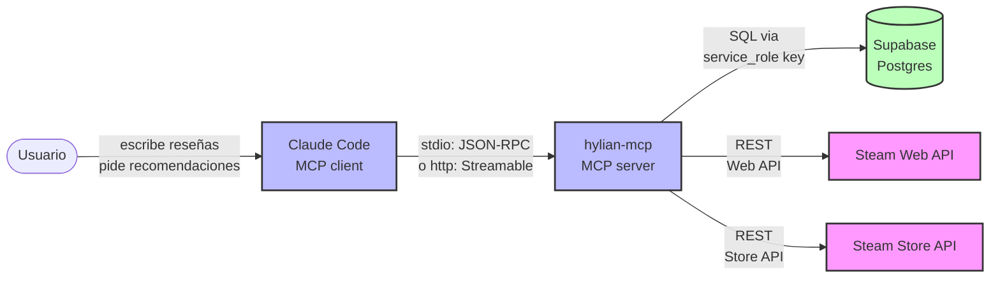
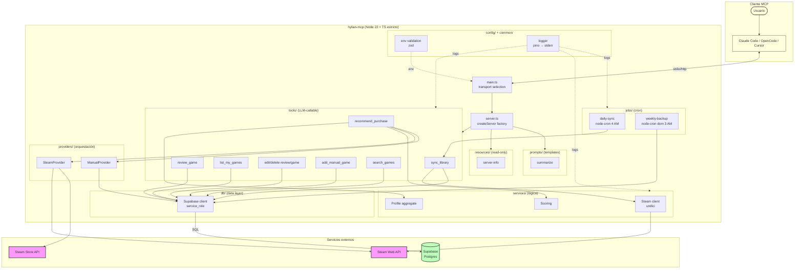
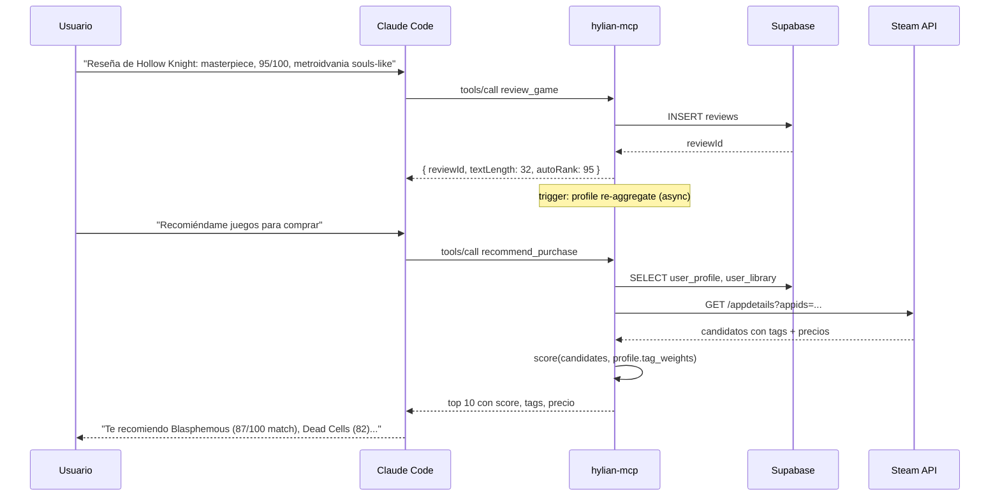

# Diagramas de Componentes (Flowcharts)

Propósito: mapa estable del sistema. Actualizar solo si cambia topología.

## Contexto (alto nivel)

## Componentes principales

## Flujo: escribir reseña → recomendación

## Notas

- **Single-user, sin Auth**: el `service_role` key bypasea RLS. No hay signup/login.
- **Stdout = protocolo MCP**: TODO logging va a stderr. No `console.log` en código de app.
- **Cron solo en producción o con opt-in**: `MCP_CRON_ENABLED=true` en dev.
- **Backups locales**: `~/.hylian-mcp/backups/`, no commiteados.
